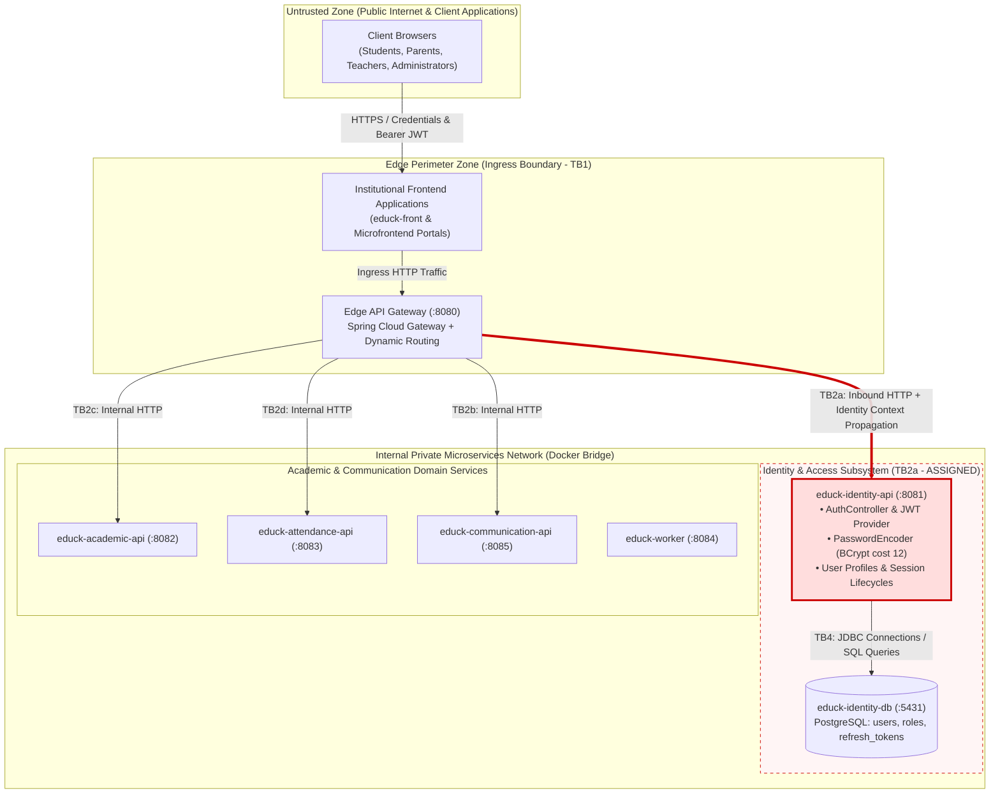

# CP1 - Attack Surface Map & Trust Boundary Topography (Identity Domain)

- **Author:** Stephan Vargas Quiroga (@stephanvargas)
- **Assigned Trust Boundary:** TB2a (`educk-api-gateway` -> `educk-identity-api`)
- **Architectural Reference Sources:** `05-architecture/overview.md`, `ADR-006-api-gateway-jwt.md`, `07-api/contracts/openapi/identity-service.yaml`.

---

## 1. System Topology & Trust Boundary Delimitation

The following architecture diagram details the distributed topology and access control boundaries of EduTrack, highlighting in red Trust Boundary **TB2a**, which serves as the core authentication authority and identity custodian for the entire platform.

### EduTrack Trust Boundary Matrix

| Boundary ID | Boundary Description | Risk Severity | Technical Custodian |
|---|---|---|---|
| TB1 | Edge Ingress from Public Internet to API Gateway | High | Team Wide |
| **TB2a** | **Inbound HTTP: Gateway -> educk-identity-api (:8081)** | **Critical (Root of Trust)** | **@stephanvargas (Issue #74)** |
| TB2b | Inbound HTTP: Gateway -> educk-communication-api (:8085) | High | @XimenaChala (Issue #66) |
| TB2c | Inbound HTTP: Gateway -> educk-academic-api (:8082) | Medium | Team Wide |
| TB2d | Inbound HTTP: Gateway -> educk-attendance-api (:8083) | High | @CelesteDussan (Issue #64) |
| TB3 | Asynchronous Event Bus (RabbitMQ `edutrack.events`) | Medium | Team Wide |
| TB4 | Persistence Boundary (Database per Service) | High | Team Wide |
| TB5 | Egress Notifications (External Email/Push Providers) | Medium | Team Wide |

---

## 2. Information Asset Inventory (Identity & Access Control)

| Asset Name | Storage & Transit Location | Data Sensitivity | Compromise Impact |
|---|---|---|---|
| **Plaintext Passwords** | Transient HTTP request payloads on `/login` and registration | Restricted | Total account takeover across institutional systems |
| **Cryptographic Hashes** | Column `users.password` (BCrypt cost 12) in PostgreSQL (:5431) | Restricted | Exposure to offline dictionary and rainbow table attacks |
| **JWT Signing Secret** | Environment variable `JWT_SECRET` in Gateway and Identity | Restricted | Forgery of arbitrary administrative access tokens |
| **Refresh Tokens** | Table `refresh_tokens` and client-side secure cookies | Restricted | Long-term session hijacking and persistence |
| **User Profiles** | Names, emails, and roles in `users` and `roles` tables | Confidential | Institutional privacy breach and user enumeration (BOLA) |
| **Context Headers** | Headers `X-User-Id` and `X-User-Role` between containers | Confidential | Authorization spoofing on downstream microservices |
| **OpenAPI Contract** | `identity-service.yaml` in `educk-docs` | Public | Architectural reconnaissance by external actors |

---

## 3. Entry Points Catalog on TB2a

| Exposed Endpoint | HTTP Verb | Active Authentication Control | Vulnerability Vector |
|---|---|---|---|
| `/api/v1/auth/login` | POST | Public; credentials verified against PostgreSQL | CPU exhaustion via unthrottled BCrypt hashing storms |
| `/api/v1/auth/refresh` | POST | Public with refresh token payload | Token reissuance without compromised family reuse detection |
| `/api/v1/auth/logout` | POST | Requires refresh token string | Local database revocation without distributed blacklist sync |
| `/api/v1/auth/users/{id}` | GET | Gateway forwards token; service omits ownership check | **BOLA / IDOR:** Arbitrary user profile extraction |
| `/api/v1/auth/validate` | POST | Header `Authorization: Bearer <token>` | Callable by any container on the flat internal network |
| TCP Port 8081 | Any protocol | Implicit trust within internal Docker network | Direct perimeter bypass and identity header spoofing |
