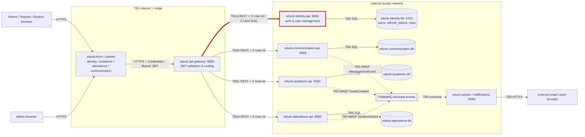

# CP1 - Attack Surface Map (EduTrack)

Sources: `05-architecture/overview.md`, `ADR-006-api-gateway-jwt.md`, `ADR-003-persistence-strategy.md`, `07-api/contracts/openapi/identity-service.yaml` of `educk-docs`.

## 1. Data-flow diagram with trust boundaries

My boundary is **TB2a** (highlighted in red).

| ID | Trust boundary | Owner |
|---|---|---|
| TB1 | Internet -> portals / `educk-api-gateway` | team |
| **TB2a** | **`educk-api-gateway` -> `educk-identity-api`** | **@stephanvargas (#74)** |
| TB2b | `educk-api-gateway` -> `educk-communication-api` | @XimenaChala (#66) |
| TB2c | `educk-api-gateway` -> `educk-academic-api` | team |
| TB2d | `educk-api-gateway` -> `educk-attendance-api` | @CelesteDussan (#64) |
| TB3 | Services <-> RabbitMQ <-> `educk-worker` | team |
| TB4 | Each service -> its own database | team |
| TB5 | `educk-worker` -> external email / push provider | team |

## 2. Asset inventory (identity & access domain)

| # | Asset | Where it lives | Classification |
|---|---|---|---|
| 1 | User credentials (plaintext passwords submitted on login/registration) | Transient in HTTP payload on TB1/TB2a, never persisted plaintext | Restricted |
| 2 | Password hashes (BCrypt work factor 12) | `users.password` in `educk-identity-db:5431` | Restricted |
| 3 | Cryptographic JWT signing secret (`jwt.secret`) | Environment variable `JWT_SECRET` in Gateway & Identity | Restricted |
| 4 | Refresh tokens (long-lived session strings) | `refresh_tokens.token` in `educk-identity-db` | Restricted |
| 5 | User profile metadata (`email`, `full_name`, assigned `roles`) | `users` and `roles` tables, response bodies on TB2a | Confidential |
| 6 | Identity context headers (`X-User-Id`, `X-User-Role`) | Internal HTTP headers forwarded across TB2a-d | Confidential |
| 7 | OpenAPI contract `identity-service.yaml` | `educk-docs` repository | Public |

## 3. Entry points of my boundary (TB2a)

| Entry point | Called by | Authentication today |
|---|---|---|
| `POST /api/v1/auth/login` | Portals via gateway | Public; credentials verified against database |
| `POST /api/v1/auth/refresh` | Portals via gateway | Public with refresh token payload |
| `POST /api/v1/auth/logout` | Portals via gateway | Authenticated via gateway; revokes refresh token |
| `GET /api/v1/auth/users/{id}` | Portals via gateway | Gateway forwards `X-User-Id`; service performs no object ownership verification |
| `POST /api/v1/auth/validate` | Internal gateway/services | Requires `Bearer` token header; verifies JWT claims |
| TCP port 8081 on internal docker network | Any container on docker network | **None** (ADR-006 assumes trusted internal bridge) |
