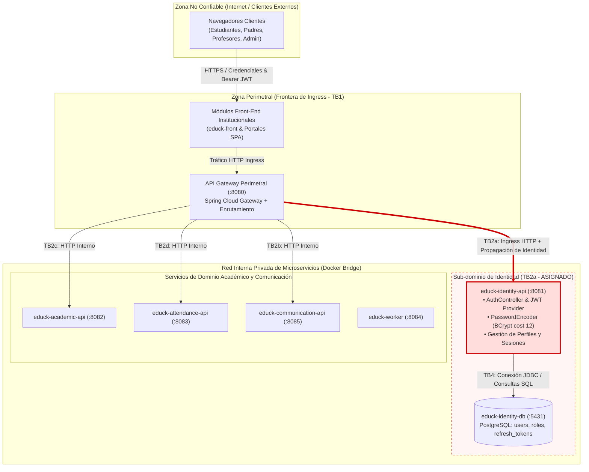

# CP1 - Mapa de Superficie de Ataque y Límites de Confianza (Dominio de Identidad)

- **Autor:** Stephan Vargas Quiroga (@stephanvargas)
- **Frontera asignada:** TB2a (`educk-api-gateway` $\rightarrow$ `educk-identity-api`)
- **Fuentes de referencia arquitectónica:** `05-architecture/overview.md`, `ADR-006-api-gateway-jwt.md`, `07-api/contracts/openapi/identity-service.yaml`.

---

## 1. Topología del Sistema y Delimitación de Fronteras de Confianza

El siguiente diagrama detalla la arquitectura de distribución y control de accesos de EduTrack, destacando en rojo la frontera **TB2a**, que constituye el núcleo de autenticación y custodia de identidades del sistema.

### Matriz de Fronteras de Confianza de EduTrack

| Código | Descripción de la Frontera | Nivel de Riesgo | Responsable Técnico |
|---|---|---|---|
| TB1 | Ingress perimetral de Internet hacia API Gateway | Alto | Equipo General |
| **TB2a** | **Canal Inbound Gateway $\rightarrow$ educk-identity-api (:8081)** | **Crítico (Raíz de Confianza)** | **@stephanvargas (Issue #74)** |
| TB2b | Canal Inbound Gateway $\rightarrow$ educk-communication-api (:8085) | Alto | @XimenaChala (Issue #66) |
| TB2c | Canal Inbound Gateway $\rightarrow$ educk-academic-api (:8082) | Medio | Equipo General |
| TB2d | Canal Inbound Gateway $\rightarrow$ educk-attendance-api (:8083) | Alto | @CelesteDussan (Issue #64) |
| TB3 | Bus de Eventos Asíncronos (RabbitMQ `edutrack.events`) | Medio | Equipo General |
| TB4 | Aislamiento de Persistencia (Cada servicio a su BD) | Alto | Equipo General |
| TB5 | Egress a Notificaciones Externas (Email/SMS) | Medio | Equipo General |

---

## 2. Inventario de Activos de Información (Identidad y Seguridad)

| Activo | Ubicación de Almacenamiento / Tránsito | Sensibilidad | Impacto ante Compromiso |
|---|---|---|---|
| **Contraseñas en Claro** | Cargas HTTP transitorias en `/login` y registro | Restringido | Suplantación total de cualquier usuario del colegio |
| **Hashes Criptográficos** | Columna `users.password` (BCrypt cost 12) en BD :5431 | Restringido | Exposición a ataques de diccionario offline |
| **Secreto de Firma JWT** | Variable de entorno `JWT_SECRET` en Gateway e Identity | Restringido | Capacidad de falsificar tokens con rol `ROLE_ADMIN` |
| **Tokens de Refresco (Refresh)** | Tabla `refresh_tokens` y almacenamiento cliente | Restringido | Secuestro y persistencia de sesiones de larga duración |
| **Perfiles de Usuario** | Datos de nombre, rol, correo en `users` y `roles` | Confidencial | Fuga de privacidad institucional y enumeración (BOLA) |
| **Headers de Contexto** | Encabezados `X-User-Id` y `X-User-Role` entre contenedores | Confidencial | Manipulación de autorización en microservicios downstream |
| **Contrato OpenAPI** | `identity-service.yaml` en `educk-docs` | Público | Reconocimiento de rutas por parte de adversarios |

---

## 3. Catálogo de Puntos de Entrada en TB2a

| Endpoint Expuesto | Verbo HTTP | Control de Autenticación Vigente | Vector Vulnerable |
|---|---|---|---|
| `/api/v1/auth/login` | POST | Público; validación contra PostgreSQL | Fuerza bruta sin throttling en capa interna |
| `/api/v1/auth/refresh` | POST | Público con token de refresco | Reemisión sin revocar token previo comprometido |
| `/api/v1/auth/logout` | POST | Token de refresco requerido | Revocación en memoria sin lista distribuida |
| `/api/v1/auth/users/{id}` | GET | Gateway reenvía token; servicio no valida dueño | **BOLA / IDOR:** Extracción de perfiles ajenos |
| `/api/v1/auth/validate` | POST | Header `Authorization: Bearer <token>` | Consumo directo sin validar red de origen |
| Puerto TCP 8081 | Cualquier protocolo | Confianza implícita en red de contenedores | Bypass directo del API Gateway (Spoofing) |
